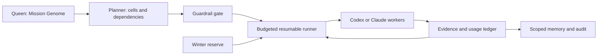

# Agent Hive

> Write a goal in any language. Compile it into a budgeted, guarded hive of specialized coding agents.

Agent Hive is a local-first orchestration kit for Codex and Claude Code. It turns a multilingual **Mission Genome** into dependency-aware **honeycomb cells**, routes each cell by capability tier, protects a recovery reserve, and emits compact `HIVE/1` worker payloads.

Prompt compression is one organ of the hive, not the whole product. The compiler compares lossless representations with a named counter; the governor decides what should run, in what order, on which tier, and when spending must stop.



## What the hive adds

- **Queen / Mission Genome** - immutable goal, constraints, language, success criteria, and guardrails.
- **Cells** - bounded work units with explicit dependencies and artifact ownership.
- **Workers** - scout, architect, forager, builder, guard, and keeper roles.
- **Energy governor** - deterministic allocation, usage ledger, budget gates, and rebalancing.
- **Winter reserve** - protected budget for verification and recovery; never released silently.
- **Prompt compiler** - compares source, `HIVE-IR`, and compact JSON without changing user literals.
- **Guardrail gate** - checks paths, network policy, destructive actions, and attempt caps.
- **Scoped memory** - local mission/team/agent memory with trust, visibility, TTL, decay, and selective recall.
- **Observability** - usage metrics, latency, alerts, evidence, and redacted JSONL audit events.
- **Resumable runner** - checkpointed execution, bounded retries, dry runs, and safe stops when usage telemetry is missing.
- **Adapters** - one shared dependency-free runtime with host-native instructions plus opt-in Codex and Claude Code CLI drivers.

## Quick start

Requires Node.js 20 or newer. The core has no npm runtime dependencies.

```powershell
npm.cmd test
node .\bin\hive.mjs run .\examples\missions\japanese-release.json --target codex --dry-run
node .\bin\hive.mjs run .\examples\missions\japanese-release.json --target codex --workspace . --state-dir .\.hive
node .\bin\hive.mjs run --resume --state-dir .\.hive --workspace .
```

`--dry-run` plans, compiles payloads, and evaluates gates without calling a model. A real run invokes the already-installed and authenticated `codex` or `claude` executable, keeps provider permission controls enabled, writes checkpoints under `.hive/`, and stops at the budget, attempt, approval, or telemetry boundary. It does not enable network access or approve destructive actions for itself. Autonomous completion requires a required `guard` cell and evidence from every completed cell.

Exit code `0` means completed or a clean dry run, `1` means invalid input/runtime failure, and `2` means a controlled incomplete stop such as a denied gate, exhausted budget, or missing evidence.

The lower-level lifecycle remains available for host-native workers and debugging:

```powershell
node .\bin\hive.mjs plan .\examples\missions\japanese-release.json --out .\.hive\plan.json
node .\bin\hive.mjs compare .\examples\missions\japanese-release.json --counter heuristic
node .\bin\hive.mjs compile .\.hive\plan.json --target codex --out-dir .\.hive\payloads
node .\bin\hive.mjs gate --plan .\.hive\plan.json --action write --path src
node .\bin\hive.mjs next .\.hive\plan.json
```

After a worker returns, record actual usage and unlock downstream cells:

```powershell
node .\bin\hive.mjs record build --status done --used 4200 --attempts 1 `
  --artifact src/result.mjs --evidence "focused tests pass" `
  --input-tokens 3000 --cached-input-tokens 1800 --output-tokens 700 `
  --reasoning-tokens 500 --latency-ms 42000 --model-calls 1
node .\bin\hive.mjs status .\.hive\plan.json
node .\bin\hive.mjs rebalance .\.hive\plan.json --out .\.hive\plan.rebalanced.json
```

The reserve opens only through an explicit decision:

```powershell
node .\bin\hive.mjs rebalance .\.hive\plan.json --release-reserve
```

Local memory is optional. New records are untrusted unless explicitly verified:

```powershell
node .\bin\hive.mjs memory put --scope mission --namespace release-42 `
  --kind decision --content "Use the existing migration path" --trusted
node .\bin\hive.mjs memory query --scope mission --namespace release-42 --trusted-only --limit 5
node .\bin\hive.mjs memory decay
```

## Mission Genome

```json
{
  "$schema": "../schemas/mission.schema.json",
  "schemaVersion": 1,
  "mission": {
    "goal": "Describe the desired outcome in any language",
    "sourceLanguage": "auto",
    "responseLanguage": "same-as-user",
    "must": ["Non-negotiable requirement"],
    "avoid": ["Forbidden outcome"],
    "doneWhen": ["Verifiable success criterion"]
  },
  "budget": { "unit": "tokens", "total": 100000, "reservePercent": 20 },
  "policy": { "maxWorkers": 3, "qualityFloor": "economy" },
  "guardrails": {
    "allowedPathPrefixes": ["src", "test"],
    "deniedPathPrefixes": [".env", ".git", "secrets", "credentials"],
    "allowNetwork": false,
    "humanApprovalActions": ["delete", "push", "deploy", "external-write"],
    "maxAttemptsPerCell": 2,
    "trustedInstructionSources": ["mission", "cell"]
  },
  "models": {
    "economy": { "codex": "your-codex-model", "claude": "your-claude-model" },
    "balanced": { "codex": "your-codex-model", "claude": "your-claude-model" },
    "frontier": { "codex": "your-codex-model", "claude": "your-claude-model" }
  },
  "cells": []
}
```

Leave `cells` empty for the default `survey -> design -> build -> verify -> distill` route, or define project-specific cells. When `allowedPathPrefixes` is non-empty, writable cells must declare workspace-relative `paths`; see [`french-gated-deploy.json`](examples/missions/french-gated-deploy.json). Model IDs are user configuration, never hard-coded assumptions.

## Token counting without false precision

```powershell
# Clearly labeled offline planning heuristic
node .\bin\hive.mjs compare mission.json --counter heuristic

# Exact text encoding through optional Python tiktoken
python -m pip install tiktoken
node .\bin\hive.mjs compare mission.json --counter openai --model YOUR_MODEL

# Anthropic message-count endpoint; requires ANTHROPIC_API_KEY
node .\bin\hive.mjs compare mission.json --counter anthropic --model YOUR_MODEL
```

Agent Hive does not assume English is always cheapest. Tokenization varies by provider, model, script, and prompt structure. Every row reports `heuristic`, `exact-text`, or `provider-estimate`; `auto` falls back visibly instead of pretending an estimate is exact.

## Install the adapters

Codex: copy or link [`plugins/codex/agent-hive`](plugins/codex/agent-hive) into a Codex plugin source and invoke `$run-agent-hive`.

Claude Code, local development:

```text
claude --plugin-dir ./plugins/claude-code/agent-hive
```

After publishing this repository as a marketplace:

```text
/plugin marketplace add mckova/agent-hive
/plugin install agent-hive@agent-hive-marketplace
```

Both adapters bundle the same core. Their skill workflow uses host-native workers by default; the optional `hive run` command calls a local provider CLI only when the user starts it.

## How it differs

| Method | Primary job | What Hive adds |
| --- | --- | --- |
| Prompt IR / prompt compression | Reduce representation cost | Dependency planning, model-tier routing, budgets, gates, evidence, and resume |
| Ralph-style loop | Repeat fresh attempts until done | Per-cell ownership, protected reserve, multilingual literals, and provider-neutral routing |
| Maker/verifier loop engineering | Govern an implementation loop | Mission Genome, task DAG, cross-provider adapters, scoped memory, and token accounting |

Hive intentionally collapses to `builder -> guard` for a small, fully specified task; extra workers must justify their own token cost.

## Benchmarks

[`benchmarks/hive-oracle`](benchmarks/hive-oracle) tests multilingual retrieval and compact answering. [`benchmarks/workflow-comparison`](benchmarks/workflow-comparison) compares a normal prompt, Caveman, Ralph Loop, Loop Engineering, and Agent Hive on the same coding fixture with hidden tests and provider-reported token fields.

```powershell
npm.cmd run benchmark:hive-oracle
```

The heuristic counter is not proof of provider savings; the live workflow comparison keeps its single-run limitations visible.

## Development and documentation

```powershell
npm.cmd test
npm.cmd run benchmark
npm.cmd run sync:plugins
npm.cmd run validate
```

Read the [architecture](docs/architecture.md), [security and observability](docs/security-and-observability.md), [memory model](docs/memory.md), [HIVE/1 protocol](docs/hive-protocol.md), [Prompt IR decision](docs/decisions/0001-hive-over-prompt-ir.md), and [limitations](docs/limitations.md).

MIT licensed. Contributions are welcome; see [CONTRIBUTING.md](CONTRIBUTING.md).
