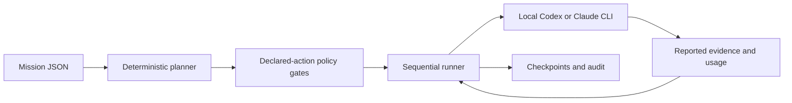

# Agent Hive

> Plan coding work as explicit tasks, route it by model tier, and track execution against a declared budget.

Agent Hive is an Alpha Python orchestration toolkit with Codex and Claude Code integrations. Its deterministic core turns a JSON **Mission Genome** into dependency-aware **cells**, assigns token or cost allocations, compiles `HIVE/1` worker prompts, and records usage and execution state.

The built-in terminal runner invokes an installed, authenticated `codex` or `claude` CLI. Plugin skills also describe a host-native workflow in which the host dispatches workers and records their results. The core is independent of a particular model generation; the available models, permissions, billing, and usage fields depend on the selected host and provider.

Try the [Hugging Face playground](https://huggingface.co/spaces/mckova/agent-hive) for a planning preview. It creates plans and prompt payloads; it does not execute coding agents or demonstrate a completed autonomous coding run.

## What is implemented

| Component | Current behavior |
| --- | --- |
| Mission and planner | Validates JSON, creates a dependency graph, assigns tiers and allocations, and groups ready cells into waves. Empty `cells` selects a deterministic six-role template. |
| Worker roles | Scout maps requirements; forager gathers evidence; architect plans; builder implements; guard checks the result; optional keeper summarizes reusable context. |
| Terminal runner | Executes ready cells **sequentially**, records transitions, retries eligible cells within an attempt cap, and supports explicit resume after controlled stops. |
| Provider drivers | Calls local Codex or Claude Code CLIs and parses their worker contracts and usage output. A mock driver supports offline protocol tests. |
| Budget ledger | Reserves part of the declared budget, allocates the remainder, and checks reported spending between calls. |
| Policy gate | Checks declared actions and path scopes before dispatch, including configured network and approval rules. |
| Prompt comparison | Compares source, `HIVE-IR`, and compact JSON with a named counter and reports literal-preservation checks. |
| Local state | Stores plans, payloads, usage, run history, redacted audit events, and optional scoped memory. |

Planning waves can contain independent cells. `policy.maxWorkers` limits those waves and host-native scheduling; it does **not** enable concurrent subprocess execution in the terminal runner. Host-native parallel dispatch is a host-managed workflow described by the skills.



## Start with an offline preview

Requires Python 3.11 or newer. The core has no required third-party runtime dependencies. Run these commands from the repository root; examples use PowerShell syntax. On other shells, use `/` path separators and the appropriate line-continuation syntax.

```powershell
python .\hive.py help
python .\hive.py validate .\examples\missions\japanese-release.json
python .\hive.py run .\examples\missions\japanese-release.json --target mock --dry-run --workspace . --state-dir .\.hive-preview
```

`--dry-run` performs deterministic planning, compiles payloads, evaluates declared gates, and writes local preview state. It makes **no planning-model or worker-model call** in this version. It does not inspect a repository semantically or execute the plan. Exit code `2` with `gate_attention_required` means the preview found a gate requiring attention.

The source entry point works without installing Agent Hive. An optional editable package installation exposes the `hive` command:

```powershell
python -m pip install -e .
hive help
```

Package installation may fetch build tooling. Codex and Claude Code must be installed and authenticated separately for real execution.

## Define the mission and review the plan

Generate an editable starting file:

```powershell
python .\hive.py init .\.hive
```

Set `mission.goal`, `must`, `avoid`, and `doneWhen` in `.hive/mission.json`. Configure `budget`, `policy`, `guardrails`, and optional `models` before running agents. The [mission schema](schemas/mission.schema.json) and [examples](examples/missions) describe the complete format.

```json
{
  "schemaVersion": 1,
  "mission": {
    "goal": "Describe the desired outcome in any language",
    "sourceLanguage": "auto",
    "responseLanguage": "same-as-user",
    "must": [],
    "avoid": [],
    "doneWhen": ["List specific checks that establish completion"]
  },
  "budget": { "unit": "tokens", "total": 100000, "reservePercent": 20 },
  "policy": { "maxWorkers": 3, "qualityFloor": "balanced" },
  "guardrails": {
    "allowedPathPrefixes": ["src", "tests"],
    "deniedPathPrefixes": [".env", ".git", "secrets", "credentials"],
    "allowNetwork": false,
    "humanApprovalActions": ["delete", "push", "deploy", "external-write"],
    "maxAttemptsPerCell": 2,
    "trustedInstructionSources": ["mission", "cell"]
  },
  "models": {},
  "cells": []
}
```

This example is a planning template. Empty `cells` creates `survey` and `forage`, then `design -> build -> verify -> distill`. The generated cells have empty path lists. Before execution with an allow-list, define concrete writable cell paths and instructions; see [the explicit-cell example](examples/missions/french-gated-deploy.json). This version does not discover repository-specific files or automatically reduce the default graph to two cells.

For a small, fully specified task, the skills recommend explicitly defining `builder -> guard`. Each declared write, delete, or external-write cell requires a required downstream guard with only read/network actions; this includes optional mutating cells. The builder implements and the guard reviews it against the acceptance criteria. The default keeper is read-only and returns reusable context. Graph checks and a non-empty reported evidence list enforce the contract; independently run the cited checks before relying on a completion claim. Push/deploy approvals do not imply automatic verification of deployment outcomes.

The mission is kept in its source language. Current normalization trims leading and trailing whitespace in the goal and constraints, and generated task text collapses whitespace. Exact byte preservation of arbitrary user input is not guaranteed.

```powershell
python .\hive.py validate .\.hive\mission.json
python .\hive.py plan .\.hive\mission.json --out .\.hive\plan.json
python .\hive.py compile .\.hive\plan.json --target codex --out-dir .\.hive\payloads
python .\hive.py next .\.hive\plan.json --usage .\.hive\usage.json
```

Review dependencies, paths, allocations, tiers, and payloads before dispatch. The autonomous runner passes bounded, untrusted dependency summaries containing artifact references, reported evidence, and reusable context. It does not read artifact contents for handoff; persist needed files in the workspace or pass selected contents through the host-native workflow.

## Execute through a local provider CLI

Real runs invoke models and can modify the chosen workspace. Start with a disposable project, a reviewed mission, and provider permissions appropriate to that work.

```powershell
python .\hive.py run .\.hive\mission.json --target codex --workspace . --state-dir .\.hive
# Alternatively, use --target claude with an authenticated Claude Code CLI.
python .\hive.py run --resume --state-dir .\.hive --workspace .
```

Configure exact model IDs in `models.<economy|balanced|frontier>.<codex|claude>`, or pass `--model` to override the terminal runner's model selection. Without a mapping or override, the provider CLI selects its default. Tier selection is deterministic policy, not a measured guarantee of model quality. The core does not provide automatic failover to arbitrary providers.

The runner writes `plan.json`, `usage.json`, `run.json`, payloads, and audit events under the state directory. Use a fresh state directory for a new run; resume reuses the saved target/workspace and completed work. Eligible retries repeat the same cell with its blockers; a guard rejection does not automatically reopen its builder. Interrupted invocations are quarantined because the action may already have executed. Inspect the artifacts and provider usage, then reconcile the confirmed outcome before resuming; do not rerun blindly.

```powershell
# Example only: replace all values with inspected cumulative usage and actual outcome.
python .\hive.py reconcile build --state-dir .\.hive --status done --used 4200 --attempts 1 --evidence "Inspected artifacts and confirmed provider usage"
python .\hive.py run --resume --state-dir .\.hive --workspace .
```

`reconcile` records an unresolved invocation's inspected outcome and confirmed cumulative spending; it does not authorize another call. See [recovery and accounting](docs/limitations.md).

Exit codes for `run` are `0` for completion or a clean preview, `1` for invalid input/runtime errors, and `2` for a controlled incomplete stop. A standalone denied `gate` command is reported as an error.

## Budget, approvals, and isolation

Budget units are `tokens` or `usd-micros`. Token spending requires complete nonnegative integer input/output totals; cached input remains part of input, and reasoning is a diagnostic subset of output rather than an extra charge. Missing reasoning diagnostics remain explicitly unknown. USD budgets require finite nonnegative `costUsd`; the Codex parser currently has no cost field. Prompt estimates, usage totals, and billing are separate measures.

Missing or incomplete telemetry marks usage unknown and stops further dispatch, including after failed calls. `status` reports known spending as a lower bound until the caller explicitly reconciles inspected outcomes and confirmed cumulative usage. Provider formats can change; never substitute a prompt estimate for unknown actual spending.

Changing an upstream ledger outcome invalidates completed dependent results while preserving their spending and attempts. This is revision tracking in the ledger, not a filesystem watcher or automatic builder repair.

Checks happen between model calls. A single call can exceed its allocation or the remaining global budget before the runner can stop; a prompt budget is not a provider-side spend cap. The reserve is excluded from routine allocation and can be released explicitly through rebalancing:

```powershell
python .\hive.py status .\.hive\plan.json --usage .\.hive\usage.json
python .\hive.py rebalance .\.hive\plan.json --usage .\.hive\usage.json --out .\.hive\plan.rebalanced.json
# Only after an explicit decision to use the reserve:
python .\hive.py rebalance .\.hive\plan.json --usage .\.hive\usage.json --release-reserve --out .\.hive\plan.rebalanced.json
```

Rebalancing writes a separate plan by default; inspect it and select the intended plan deliberately. Do not assume a saved run automatically adopts a separately written revision.

The gate evaluates declared actions and scopes. `--approve <action>` on `run`, or `--human-approved` on `gate`, is a caller assertion of actual approval, not an approval authentication system. Bind it to a real human decision in the host workflow.

Agent Hive does not create an operating-system sandbox or enforce per-tool network and filesystem access itself. Codex sandbox settings and Claude Code permission controls remain the execution boundary. A read-only role label or `NETWORK: denied` prompt line alone cannot restrict a process. Scoped memory filters are application-level organization, not tenant authentication or encryption. See [limitations](docs/limitations.md) and [security and observability](docs/security-and-observability.md).

## Host-native adapters

Both plugin trees bundle the same Python runtime and a `run-agent-hive` skill:

- [Codex plugin](plugins/codex/agent-hive): load it using the plugin-source mechanism supported by your Codex host, then invoke `$run-agent-hive`.
- [Claude Code plugin](plugins/claude-code/agent-hive): for local development, start `claude --plugin-dir ./plugins/claude-code/agent-hive` from this repository.

The repository also contains [Claude marketplace metadata](.claude-plugin/marketplace.json) for `/plugin marketplace add mckova/agent-hive` and `/plugin install agent-hive@agent-hive-marketplace`.

These integrations include real CLI drivers, not only abstract extension points. Their installed operation still depends on the host's supported plugin format and CLI output. Host-native skills ask the host to schedule and gate workers, pass dependency artifacts, and record cumulative usage. Claude's bundled workers map economy/balanced/frontier to Haiku/Sonnet/Opus aliases; exact autonomous model IDs are mission configuration. Additional host integrations would require an adapter; `--target generic` compiles payloads and is not an autonomous provider driver.

## Prompt counters and optional memory

```powershell
python .\hive.py compare .\.hive\mission.json --counter heuristic
```

The default `utf8-bytes/4` counter is an offline planning heuristic. Optional `tiktoken` support (`python -m pip install -e '.[openai-count]'`) counts encoded text for a supported `--counter openai --model <id>`, excluding full API framing, tools, and output. `--counter anthropic --model <id>` requires `ANTHROPIC_API_KEY` and sends each candidate to Anthropic's message-count endpoint. `auto` may also use that endpoint when configured. These are explicit network operations, separate from offline `--dry-run`.

Every comparison row labels precision as `heuristic`, `exact-text`, or `provider-estimate`. Language and representation affect tokenization; there is no universal claim that English or a compact prompt is cheaper.

Memory is optional and managed through the CLI. Records are untrusted by default. Mark a record trusted only after verification, and keep secrets out of all state files. Queries exclude TTL-expired records; `memory decay` also removes them from storage and applies retention cleanup.

```powershell
python .\hive.py memory put --scope mission --namespace example --kind decision --content "Verified reusable decision"
python .\hive.py memory query --scope mission --namespace example --limit 5
python .\hive.py memory decay
```

Memory is not automatically recalled into every terminal worker prompt. Audit events are locally redacted JSONL records; they are not tamper-evident logs, and alerts are read through `status` rather than a monitoring daemon.

## Evidence and benchmarks

The committed experiments are historical evidence, with their original models and dates preserved:

- [Workflow comparison](benchmarks/workflow-comparison/results/REPORT.md), dated **2026-08-05**, used GPT-5.5 and Codex CLI 0.130.0 on the original JavaScript fixture. All primary approaches achieved the same reported artifact quality. Compact Hive reduced several token fields relative to the earlier full Hive run, while wall time increased. These single runs do not establish general quality, speed, or cost improvements. The current reproducibility fixture is Python and should not be presented as the fixture used for those recorded results.
- [HotpotQA oracle](benchmarks/hive-oracle/results/REPORT.md), dated **2026-08-05**, records a six-question disjoint holdout using `gpt-5.6-sol`. It compares a separate benchmark harness's direct, retrieval, fixed Hive, and adaptive memory paths. Its small sample and particular baselines do not validate general coding-runner performance or a universal saving.

Model names in those reports describe the experiments, not product requirements. The [live oracle command](benchmarks/hive-oracle/README.md) fetches data and makes paid model calls when configured; it is not an offline quick-start command. No new live benchmark is implied by a successful mock test.

## Development and documentation

From a disposable development checkout:

```powershell
python -m unittest discover -s tests -t . -v
python .\scripts\benchmark.py
python .\scripts\validate_repo.py
```

`scripts/benchmark.py` is the local deterministic prompt-count benchmark. If you intentionally change core files, `python .\scripts\sync_plugin_runtime.py` copies the shared runtime into plugin trees; it is a maintenance write operation. Review the resulting copies and rerun validation.

Read the [architecture](docs/architecture.md), [HIVE/1 protocol](docs/hive-protocol.md), [memory model](docs/memory.md), [security and observability](docs/security-and-observability.md), [Prompt IR decision](docs/decisions/0001-hive-over-prompt-ir.md), and [limitations](docs/limitations.md).

## License

Agent Hive is MIT licensed. Keep the copyright and permission notices with copies or substantial portions of the software. See [LICENSE](LICENSE) and [NOTICE](NOTICE).

```text
Copyright (c) 2026 May Sidon | Agent Hive | https://github.com/mckova/agent-hive
```

Contributions are welcome; see [CONTRIBUTING.md](CONTRIBUTING.md).
